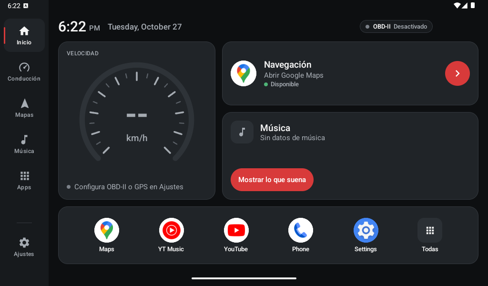
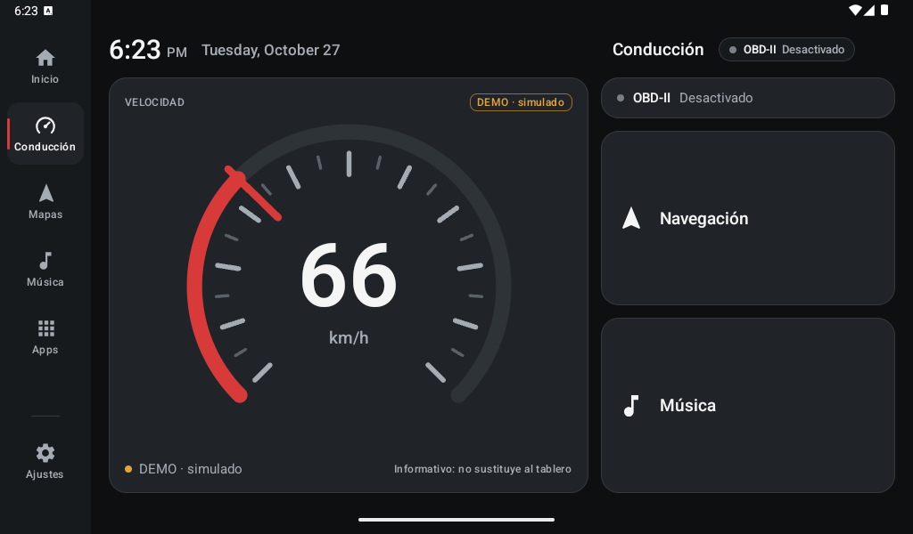
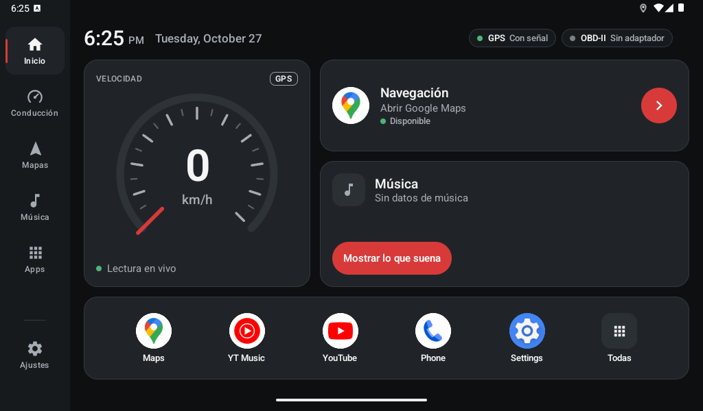
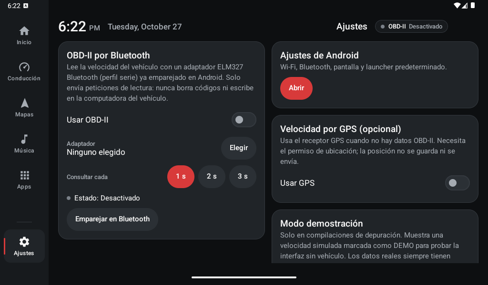

# TopwayLauncher · Altima Cockpit

Launcher Android propio para la radio de automóvil **Topway TS7** (placa **SL8141E**), instalada
en un **Nissan Altima 2007**. Hecho con Kotlin y Jetpack Compose, para pantallas horizontales,
legible a distancia y sin root ni API privadas.

**Altima Cockpit** es su diseño: una interfaz automotriz sobria, inspirada en la instrumentación
digital y en la organización de CarPlay, sin copiar interfaces, logotipos ni recursos de nadie.



> **Estado:** 0.2.0. Funciona como app normal; **todavía no** reemplaza el launcher del sistema.
> Probado en el emulador. **No se ha probado en la radio ni con un adaptador OBD-II real.**

## Funciones

### Implementadas y probadas en el emulador

- **Identidad Altima Cockpit:** grafito `#0D0F11`, tarjetas opacas `#202428` con borde `#34393F`
  y rojo de instrumentación `#D83A3A` solo en la aguja, la selección y los botones principales.
  Paleta centralizada en `ui/theme/Theme.kt`. Sin vidrio, neones ni animaciones permanentes.
- **Barra lateral (~10 % del ancho):** Inicio, Conducción, Mapas, Música, Apps y, separado,
  Ajustes. Selección con un testigo rojo fino. Con poca altura se ocultan las etiquetas (los
  botones siguen accesibles por su descripción), pero nunca se recorta ningún botón.
- **Cabecera:** hora, fecha local y estado real de **OBD-II** (siempre) y **GPS** (solo si el
  usuario lo activó y concedió el permiso). Mantener pulsada la hora muestra la información
  del equipo, útil para diagnosticar la radio.
- **Tarjeta de velocidad:** velocímetro de 270° dibujado en un único Canvas, con la cifra grande,
  la unidad, la fuente (`OBD-II`, `GPS` o `DEMO · simulado`) y su estado. Sin fuente muestra
  **«--»**, nunca 0. Al tocarla se abre el modo Conducción.
- **Tarjeta de navegación:** abre Google Maps con su URL pública (sin API key ni permisos). Indica
  si está disponible; si no hay app de mapas, ofrece **Ver aplicaciones**.
- **Tarjeta de música** (conservada): estado vacío sin inventar datos, apertura de la app de
  música y, si el usuario concede el acceso a notificaciones, lo que suena con sus controles y el
  tinte suave de la carátula.
- **Accesos rápidos:** recientes y, al principio, Maps, música, YouTube, Teléfono y Ajustes
  (solo los instalados), más **Todas**.
- **Apps:** cuadrícula paginada (conservada), adaptada al espacio real.
- **Modo Conducción:** velocidad grande, estado de las fuentes y protocolo OBD detectado, y dos
  accesos grandes (Navegación y Música). Sin gráficas, sin controles de desarrollo y sin sonidos.
- **Ajustes del launcher:** acceso a los Ajustes de Android, configuración de OBD-II, GPS
  opcional y modo demostración (solo en depuración).
- **Velocidad por GPS (opcional):** `LocationManager`, sin servicios de Google. Probado en el
  emulador con posiciones simuladas: 30 nudos → 56 km/h; al desactivar la ubicación pasa a «--» y
  «Sin datos recientes».

### Implementadas, pendientes de probar con hardware real

- **OBD-II por Bluetooth (ELM327):** conexión, preparación, consulta del PID `01 0D`, timeouts,
  reconexión y estados de error. Probado con un adaptador simulado en las pruebas unitarias.
  Detalles en [docs/OBD-II.md](docs/OBD-II.md).

### Pendientes

- Probar en la radio Topway y con un adaptador ELM327 en el Altima.
- RPM y temperatura del refrigerante: interpretación lista y probada, **no se consultan** hasta
  validar la velocidad en el vehículo.
- Modo launcher (preparado y desactivado: [docs/MODO_LAUNCHER.md](docs/MODO_LAUNCHER.md)).
- Sin mapa integrado, widgets, búsqueda, carpetas ni reordenación de iconos.

| Conducción (demo) | Velocidad por GPS | Ajustes |
|---|---|---|
|  |  |  |

Capturas del emulador `Topway_1024x600` (1024 × 600, 160 dpi). La velocidad de la primera es
**simulada** y aparece marcada como `DEMO`; la del GPS viene del proveedor GPS del emulador.

## Reglas sobre los datos del vehículo

- Sin una fuente reciente, la velocidad es **desconocida («--»)**. Nunca se muestra 0 por falta
  de datos ni el último valor como si fuera actual.
- Prioridad fija: OBD-II reciente → GPS reciente → demo (solo en depuración) → desconocida. Nunca
  se promedian ni se mezclan fuentes, y la fuente se muestra siempre.
- La demostración solo existe en compilaciones de depuración, está desactivada por defecto, se
  marca en ámbar como `DEMO · simulado` y nunca tiene prioridad sobre datos reales.
- La velocidad es **informativa** y no sustituye al tablero del vehículo.

## Permisos

| Permiso | Para qué | Cuándo se pide |
|---|---|---|
| `BLUETOOTH` (Android ≤ 11) | Conectar con el adaptador OBD-II ya emparejado | Al instalar (permiso normal) |
| `BLUETOOTH_CONNECT` (Android 12+) | Lo mismo | Al pulsar **Elegir** adaptador en Ajustes |
| `ACCESS_FINE_LOCATION` | Velocidad del GPS | Al activar **Usar GPS**, tras explicar el motivo |
| `ACCESS_COARSE_LOCATION` | Android 12+ obliga a pedirlo junto con el anterior | Igual; con solo la aproximada el GPS no se activa y se explica por qué |

- No se piden permisos de escaneo Bluetooth ni de ubicación para Bluetooth: solo se usan
  dispositivos **ya emparejados** en Android.
- **Sin permiso de Internet.** Nada se envía a servidores. La ubicación no se guarda ni se
  registran trayectos: de cada posición solo se toma la velocidad.
- El acceso a notificaciones de la tarjeta de música sigue siendo opcional y lo concede el
  usuario en Ajustes de Android (ver más abajo).
- `ManifestPermissionsTest` falla si alguien añade un permiso que no está en esta lista.

## Requisitos

- Android Studio reciente (probado con la build 2026.1, `AI-261`), JDK 17+ (sirve el JBR incluido).
- Android SDK Platform 36 y Build-Tools 36.
- Para OBD-II: adaptador **ELM327 Bluetooth Classic (SPP)**. Los adaptadores solo BLE no se admiten.

| Componente | Versión |
|---|---|
| Kotlin (plugin compilador Compose) | 2.3.20 |
| Android Gradle Plugin | 9.1.0 (Kotlin integrado) |
| Gradle (wrapper) | 9.3.1 |
| Jetpack Compose BOM | 2026.05.00 (Material 3) |
| compileSdk / targetSdk | 36 |
| minSdk | 23 (Android 6.0) |

**Dependencias:** las de la versión 0.1.0, sin añadidos en la app. Solo para las pruebas de
interfaz se añadieron `ui-test-junit4`, `ui-test-manifest`, `androidx.test.ext:junit` 1.3.0 y
`androidx.test:runner` 1.7.0. No entran en el APK de la radio, salvo `ui-test-manifest`, que
solo está en la compilación de depuración.

## Arquitectura

```
app/src/main/java/com/morado/topwaylauncher/
├── MainActivity.kt
├── data/
│   ├── AppRepository.kt, AppInfo.kt, AppListRules.kt, DockRules.kt, RecentAppsStore.kt
│   ├── ExternalShortcut.kt, MediaSessionRepository.kt, MediaListenerService.kt
│   ├── NowPlaying.kt, AmbientColor.kt, DeviceInfo.kt
│   └── vehicle/                     Velocidad: OBD-II, GPS y selección de fuente
│       ├── ObdResponseParser.kt     Respuestas ELM327 (puro, con pruebas)
│       ├── Elm327Session.kt         Comandos permitidos y preparación del adaptador
│       ├── BluetoothObd.kt          Bluetooth Classic / SPP
│       ├── ObdConnectionManager.kt  Conexión, consultas, timeouts y reconexión
│       ├── GpsSpeedSource.kt        Velocidad del GPS
│       ├── SpeedSelector.kt         Qué fuente mostrar y cuándo un dato es antiguo
│       ├── VehicleTelemetryRepository.kt, VehicleSettingsStore.kt, VehicleTelemetry.kt
└── ui/
    ├── home/       HomeScreen, DashboardContent, AppsContent, HomeViewModel
    ├── vehicle/    VehicleViewModel, SpeedGauge, VehicleStatus (tarjeta e indicadores),
    │               DriveContent (Conducción), SettingsContent (Ajustes)
    ├── components/ NavRail, ClockHeader, AppPager, AppIcon, AmbientBackground
    └── theme/      Paleta, medidas y tipografía Altima Cockpit
```

Un solo `Activity` con Compose y dos ViewModels: `HomeViewModel` (apps, mapas y música) y
`VehicleViewModel` (velocidad). El estado del vehículo se pasa como `State` y solo lo leen la
tarjeta de velocidad, la cabecera y Conducción, de modo que un cambio de velocidad no recompone
la pantalla entera.

## Compilar y probar

```powershell
.\gradlew.bat assembleDebug                      # APK: app\build\outputs\apk\debug\app-debug.apk
.\gradlew.bat testDebugUnitTest lintDebug        # Pruebas unitarias y lint
$env:ANDROID_SERIAL="emulator-5560"              # Elegir el emulador si hay varios conectados
.\gradlew.bat connectedDebugAndroidTest          # Pruebas de interfaz (necesita emulador)
```

En Linux/macOS usar `./gradlew`. `local.properties` lo crea Android Studio y no se versiona.

### Resultados (2026-10-27, PC de desarrollo)

| Comprobación | Resultado |
|---|---|
| `assembleDebug` | Correcto |
| `testDebugUnitTest` | 61 pruebas, 0 fallos (parser OBD, sesión ELM327, gestor de conexión, selector de fuente, permisos, dock, lista de apps, música) |
| `connectedDebugAndroidTest` | 13 pruebas, 0 fallos, en `Topway_1024x600` (API 35) |
| `lintDebug` | 0 errores; avisos solo por versiones más nuevas disponibles y una regla de copia de seguridad que ya existía |

Las pruebas de interfaz cubren: inicio de la app, velocidad desconocida, valor OBD, demo
identificada, datos antiguos, GPS visible solo si está activo, mapas ausentes, música vacía,
navegación entre secciones, recreación de la actividad y barra lateral con poca altura.

### Rendimiento medido (emulador, no la radio)

| Medición | Resultado |
|---|---|
| CPU con la velocidad fija (sin cambios) | 0,0–0,2 % (sin animaciones permanentes) |
| CPU con la velocidad cambiando cada 2 s (GPS simulado) | 4–5 % |
| Frames durante 30 s de cambios | 288 frames; p50 17 ms, p90 21 ms (GPU emulada) |
| Memoria (PSS total) | ~156 MB en el emulador API 35 |
| GPS en segundo plano | Se libera ~5 s después de salir de la app (verificado con `dumpsys location`) |

**Pendiente en la radio:** las mismas mediciones con `adb shell top` y `dumpsys gfxinfo` (o
Android Studio Profiler). El emulador usa GPU por software y otro procesador, así que estas
cifras no predicen el comportamiento del SL8141E.

## Ejecutar en el emulador

1. **File → Open** la carpeta `TopwayLauncher` y esperar a que sincronice Gradle.
2. Crear un dispositivo parecido a la radio en **Device Manager**: tablet de 7" (o *New hardware
   profile*) con **1024 × 600** y **160 dpi**, imagen API 35 con Google Play, en horizontal. En
   este equipo existe como `Topway_1024x600`.
3. Elegir la configuración **app** y pulsar **Run ▶**. Se abre como una app normal.
4. Para probar la velocidad sin vehículo:
   - **Demo:** Ajustes → Modo demostración → *Datos simulados* (solo en depuración).
   - **GPS:** Ajustes → *Usar GPS*, conceder la ubicación precisa y enviar posiciones con
     velocidad desde *Extended controls → Location* o con
     `adb emu geo fix -122.084 37.422 5 8 30` (el último valor es la velocidad en nudos).
   - **Sin datos:** desactivar la ubicación del emulador: la velocidad pasa a «--».
5. Para ver otras proporciones, redimensionar la ventana o usar otro perfil.

## Pruebas en la radio y OBD-II

- Instalación en la radio: [docs/PRUEBAS.md](docs/PRUEBAS.md). Requiere autorización del propietario.
- Adaptador y vehículo: [docs/OBD-II.md](docs/OBD-II.md#prueba-en-el-vehiculo).

### Configurar OBD-II

1. Emparejar el adaptador en **Ajustes de Android → Bluetooth**.
2. TopwayLauncher → **Ajustes → OBD-II por Bluetooth → Elegir** (en Android 12+ pide el permiso
   de Bluetooth) → elegir el adaptador. *Usar OBD-II* se activa solo.
3. *Consultar cada*: 1 s (por defecto), 2 s o 3 s.
4. El estado y el protocolo detectado aparecen en Ajustes, en la cabecera y en Conducción.

### Mostrar lo que suena (opcional)

Leer qué reproduce otra app exige que el usuario dé a TopwayLauncher el **acceso a
notificaciones**: en la tarjeta de Música, **Mostrar lo que suena** → **Ir a Ajustes** → activar
TopwayLauncher. El servicio `MediaListenerService` está vacío: no lee, guarda ni envía
notificaciones. Se retira en *Ajustes → Notificaciones → Acceso a notificaciones*.

## Limitaciones conocidas

- **No probado en la radio.** Versión de Android, resolución, densidad, rendimiento y Bluetooth
  del SL8141E están sin confirmar (mantener pulsada la hora los muestra).
- **OBD-II no probado con hardware.** Se desconoce si el Altima 2007 informa el PID `0D` y con qué
  protocolo; la app lo detecta y lo indica. Muchos clones de ELM327 son poco fiables.
- Si el firmware de la radio no ofrece Bluetooth Classic a las apps o limita el acceso a
  dispositivos emparejados, OBD-II no funcionará; el GPS sigue siendo una alternativa si la radio
  tiene receptor.
- Las fuentes solo trabajan con el launcher visible: con Google Maps delante no se lee la
  velocidad (decisión de consumo; se puede revisar más adelante).
- La conexión OBD se reinicia al volver a la app (unos segundos para «Conectado»).
- Lo que suena depende de que la app de música publique una sesión multimedia estándar; el acceso
  a notificaciones puede estar bloqueado en la radio.
- Sin mapa integrado: la tarjeta de navegación abre la app externa.
- La etiqueta de la app sigue siendo *TopwayLauncher* (el nombre que aparece en Ajustes de
  Android); *Altima Cockpit* es el nombre del diseño. Cambiarlo es una decisión pendiente.

## Cómo contribuir

1. Abrir un *issue* describiendo el cambio o el problema (incluir versión de Android y modelo si
   es un fallo en la radio; para OBD-II, el modelo del adaptador y el protocolo que muestra la app).
2. Crear una rama desde `main`.
3. Mantener el estilo existente y ejecutar `.\gradlew.bat assembleDebug testDebugUnitTest lintDebug`
   (y `connectedDebugAndroidTest` si cambia la interfaz).
4. Abrir un *pull request* explicando qué se probó y en qué dispositivo.

No incluir claves de firma, contraseñas, credenciales, direcciones MAC de adaptadores ni ubicaciones.

## Licencia

El repositorio incluye una licencia [MIT](LICENSE). **Propuesta pendiente de aprobación** del
propietario antes de publicar el proyecto.

## Aviso

Proyecto independiente, sin relación con Topway ni con Nissan. No modifica el firmware, no
requiere root y no cambia ajustes de fábrica. Las marcas se mencionan solo para identificar el
equipo y el vehículo. La lectura OBD-II solo envía peticiones de lectura.
